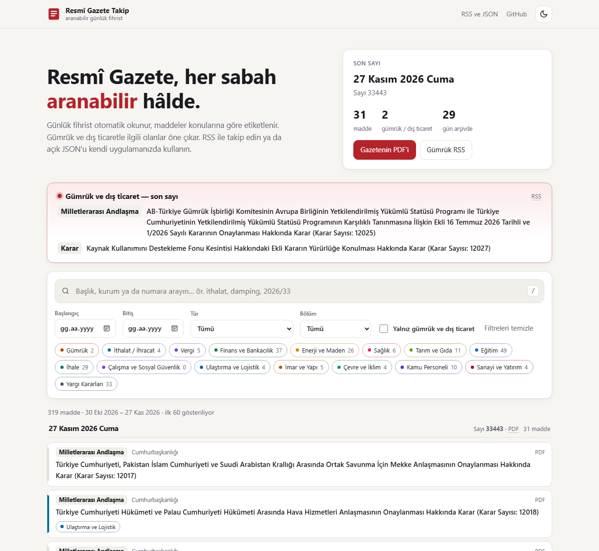

# Resmî Gazete Takip

[](https://github.com/demiralpozturk/resmi-gazete-takip/actions/workflows/guncelle.yml)
[](https://github.com/demiralpozturk/resmi-gazete-takip/actions/workflows/test.yml)
[](LICENSE)


**Resmî Gazete'yi her sabah otomatik okuyup aranabilir bir web sitesine, RSS akışlarına ve açık JSON'a dönüştürür.** Maddeler konularına göre etiketlenir; gümrük ve dış ticaretle ilgili olanlar öne çıkarılır.

**🌐 Canlı site:** https://demiralpozturk.github.io/resmi-gazete-takip/



*[English below](#english)*

## Neden?

Resmî Gazete her gün onlarca madde yayımlıyor. Gümrük müşavirleri, dış ticaret, vergi ve hukuk ekipleri ilgili olanları bulmak için her sabah fihristi elle tarıyor. Bu proje fihristi kendiliğinden okur, her maddeyi tür, kurum ve konu kategorisiyle etiketler, sonra herkesin kullanabileceği biçimlerde yayımlar:

- arama ve filtrelerle gezilebilen bir **web sitesi**,
- yalnızca ilgilendiğiniz konuları getiren **RSS akışları**,
- kendi uygulamanıza bağlayabileceğiniz **açık JSON**,
- isterseniz her sabah **Telegram bildirimi**.

## Özellikler

- 🗓️ **Her gün otomatik:** GitHub Actions her sabah 07:15'te (TR) günün sayısını, gece 23:30'da gün içinde çıkan mükerrer sayıları toplar. Yalnızca yeni içerik varsa commit atılır.
- 🔎 **Aranabilir site:** Türkçe karakter duyarsız arama (`gumruk` = `GÜMRÜK`), tarih aralığı, tür, bölüm ve kategori filtresi. Filtreler adres çubuğuna yazılır, bağlantıyı paylaşabilirsiniz.
- 🏷️ **16 konu kategorisi:** gümrük, ithalat/ihracat, vergi, finans, enerji, sağlık, tarım ve gıda, eğitim, ihale, çalışma, ulaştırma, imar, çevre, kamu personeli, sanayi ve yatırım, yargı. [`config/kategoriler.yml`](config/kategoriler.yml) ile genişletebilirsiniz.
- 🏛️ **Kurum adı:** Mevzuat metninin başındaki satırdan otomatik çıkarılır ("Ticaret Bakanlığından:" → *Ticaret Bakanlığı*).
- 📑 **Mükerrer sayılar:** Aynı gün yayımlanan 1., 2., … mükerrer sayılar ayrı ayrı işlenir.
- 📡 **RSS:** Tüm maddeler, her kategori ayrı ve gümrük + dış ticaret birleşik akışı.
- 📦 **Açık JSON:** Gün dosyaları, son 90 gün, dizin ve kategori tanımları. Anahtar gerektirmez.
- 📣 **Telegram (isteğe bağlı):** Seçtiğiniz kategorilerdeki yeni maddeler her sabah kanalınıza ya da grubunuza gelir.
- 🙂 **Nazik toplayıcı:** İstekler sıralı gider, aralarında bekleme vardır. Günde yalnızca birkaç istek atılır.

## Veri adresleri

| Dosya | İçerik |
|---|---|
| [`data/latest.json`](https://demiralpozturk.github.io/resmi-gazete-takip/data/latest.json) | Son günün tüm maddeleri ve sayı bilgisi |
| [`data/index.json`](https://demiralpozturk.github.io/resmi-gazete-takip/data/index.json) | Arşivdeki bütün günler: sayılar, madde ve kategori adetleri |
| [`data/son90.json`](https://demiralpozturk.github.io/resmi-gazete-takip/data/son90.json) | Son 90 günün maddeleri, yeniden eskiye |
| `data/YYYY/AA/GG.json` | Tek bir gün, ör. [`data/2026/11/27.json`](https://demiralpozturk.github.io/resmi-gazete-takip/data/2026/11/27.json) |
| [`data/kategoriler.json`](https://demiralpozturk.github.io/resmi-gazete-takip/data/kategoriler.json) | Kategori kodları, adları, renkleri ve toplam adetleri |

Aynı dosyalara depodan da erişebilirsiniz: `https://raw.githubusercontent.com/demiralpozturk/resmi-gazete-takip/main/data/latest.json`

### Madde şeması

```json
{
 "id": "20261126-4",
 "tarih": "2026-11-26",
 "sayi": 33442,
 "mukerrer": 0,
 "bolum": "YÜRÜTME VE İDARE BÖLÜMÜ",
 "tur": "TEBLİĞ",
 "tur_kisa": "Tebliğ",
 "baslik": "İthalatta Haksız Rekabetin Önlenmesine İlişkin Tebliğ (No: 2026/33)",
 "kurum": "Ticaret Bakanlığı",
 "url": "https://www.resmigazete.gov.tr/eskiler/2026/11/20261126-4.htm",
 "bicim": "htm",
 "sira": 4,
 "kategoriler": ["dis-ticaret"]
}
```

| Alan | Açıklama |
|---|---|
| `id` | Kalıcı kimlik (Resmî Gazete'deki dosya adından; ilanlar `ilan-` önekli) |
| `tarih`, `sayi`, `mukerrer` | Yayım tarihi, sayı numarası, mükerrer sırası (asıl sayı için `0`) |
| `bolum`, `tur` | Fihristteki bölüm ve tür başlığı, olduğu gibi |
| `tur_kisa` | Sadeleştirilmiş tür: Yönetmelik, Tebliğ, Karar, Kanun, Genelge, Yargı Kararı, İlan… |
| `kurum` | Yayımlayan kurum. Çıkarılamadıysa `null` |
| `url`, `bicim` | Asıl metnin adresi ve biçimi (`htm` / `pdf`) |
| `kategoriler` | Konu etiketleri (kodlar [`kategoriler.json`](https://demiralpozturk.github.io/resmi-gazete-takip/data/kategoriler.json)'da) |

## RSS akışları

| Akış | Adres |
|---|---|
| Tüm maddeler | [`feed.xml`](https://demiralpozturk.github.io/resmi-gazete-takip/feed.xml) |
| **Gümrük ve Dış Ticaret** | [`feeds/gumruk-dis-ticaret.xml`](https://demiralpozturk.github.io/resmi-gazete-takip/feeds/gumruk-dis-ticaret.xml) |
| Tek kategori | `feeds/<kod>.xml`, ör. [`feeds/vergi.xml`](https://demiralpozturk.github.io/resmi-gazete-takip/feeds/vergi.xml) |

Kategori kodları: `gumruk`, `dis-ticaret`, `vergi`, `finans`, `enerji`, `saglik`, `tarim-gida`, `egitim`, `ihale`, `calisma`, `ulastirma`, `imar`, `cevre`, `kamu-personeli`, `sanayi-yatirim`, `yargi`.

## Kategorileri düzenleme

Kurallar [`config/kategoriler.yml`](config/kategoriler.yml) dosyasında. Yeni bir kategori için bir blok eklemeniz yeterli:

```yaml
  rekabet:
    ad: Rekabet
    aciklama: Rekabet Kurumu kararları ve rekabet hukuku
    renk: "#0891b2"
    anahtar_kelimeler: [rekabet, birleşme ve devralma]   # başlıkta kelime başında eşleşir, ek alabilir
    tam_kelimeler: [rk]                                   # başlıkta yalnız kelimenin tamamı
    haric: [haksız rekabet]                               # başlıkta bunlar geçerse etiketleme
    kurumlar: [Rekabet Kurumu]                            # yayımlayan kurumun adında geçerse
```

Anahtar kelimeler bilerek yalnız başlıkta aranır; kurum adındaki kelimeler yanlış etiket üretmesin diye kurum eşleşmesi ayrı bir `kurumlar` listesiyle yapılır.

Ardından `python -m rgtakip turet` çalıştırın: bütün arşiv yeni kurallarla yeniden etiketlenir, RSS akışı kendiliğinden oluşur.

## Kendi kopyanızı çalıştırın

1. Depoyu **fork**'layın.
2. **Actions** sekmesinde iş akışlarını etkinleştirin.
3. **Settings → Pages → Source:** *GitHub Actions* seçin.
4. **Actions → Resmî Gazete güncelle → Run workflow** ile ilk çalıştırmayı yapın (son 30 gün dolar).

Site `https://<kullanıcı-adınız>.github.io/resmi-gazete-takip/` adresinde yayımlanır. RSS'teki bağlantılar fork'unuzun adresine göre kendiliğinden ayarlanır (`GITHUB_REPOSITORY`). Özel alan adı kullanacaksanız `RG_SITE_URL` değişkenini tanımlayın.

### Telegram bildirimi

1. Telegram'da [@BotFather](https://t.me/BotFather) ile bir bot oluşturup belirteci (token) alın, botu kanalınıza ya da grubunuza ekleyin.
2. Depoda **Settings → Secrets and variables → Actions** altına iki *secret* ekleyin: `TELEGRAM_BOT_TOKEN`, `TELEGRAM_CHAT_ID`.
3. İsteğe bağlı olarak `TELEGRAM_KATEGORILER` *variable*'ı tanımlayın (ör. `gumruk,dis-ticaret,vergi` ya da `hepsi`). Boş bırakırsanız gümrük ve dış ticaret gönderilir.

Secret'lar tanımlı değilse bu adım sessizce atlanır.

## Yerel geliştirme

```bash
python -m venv .venv
source .venv/bin/activate          # Windows: .venv\Scripts\activate
pip install -r requirements-dev.txt

python -m rgtakip guncelle --gun 7     # son 7 günü indir (var olan günler atlanır)
python -m rgtakip site --sun 8000      # siteyi derle, http://127.0.0.1:8000 adresinde aç
pytest                                 # testler (gerçek sayfa örnekleriyle)
```

| Komut | Ne yapar |
|---|---|
| `guncelle [--gun 30] [--mukerrer-gun 3] [--gecikme 2]` | Eksik günleri ve yeni mükerrerleri indirir, JSON ve RSS üretir |
| `turet` | Ağa çıkmadan, kayıtlı veriden JSON ve RSS'i yeniden üretir (kategori değişikliklerinden sonra) |
| `site [--cikti _site] [--sun PORT]` | Statik siteyi derler, istenirse yerelde sunar |
| `ozet yeni.json` | Son güncellemenin tek satırlık özeti (commit mesajı) |
| `telegram yeni.json` | Yeni maddeleri Telegram'a gönderir (ayar yoksa atlar) |

## Nasıl çalışır?

```
resmigazete.gov.tr/fihrist?tarih=…      ← her sabah GitHub Actions
          │  ayrıştır: bölüm · tür · başlık · bağlantı · sayı · mükerrer
          │  HTM metnin başlığından kurum adı
          ▼
   config/kategoriler.yml ile etiketle
          ▼
 data/YYYY/AA/GG.json ─► index.json · latest.json · son90.json
          ├─► feed.xml · feeds/<kategori>.xml
          └─► docs/ (site) ──► GitHub Pages
```

Toplayıcı sitenin `robots.txt` kurallarına uyar, istekleri sıralı ve aralarında bekleyerek gönderir, genel bir User-Agent kullanır. Sıradan bir günde 5–15 istek atar. Var olan günler yeniden indirilmez.

## Sorumluluk reddi

Bu proje **resmî değildir** ve T.C. Resmî Gazete ile bağlantısı yoktur. Veriler otomatik olarak toplanır ve etiketlenir; hata içerebilir. Hukuki işlemlerde her zaman [resmigazete.gov.tr](https://www.resmigazete.gov.tr/)'deki asıl metni esas alın.

## Katkı

Hata bildirimi, kategori önerisi ve pull request'ler memnuniyetle karşılanır. Kategori kuralı önerirken yanlış eşleşen ya da kaçırılan madde başlıklarını örnek olarak eklemeniz çok yardımcı olur.

## Lisans

[MIT](LICENSE) © 2026 [Demiralp Öztürk](https://github.com/demiralpozturk)

---

## English

**Resmî Gazete Takip** turns Turkey's *Official Gazette* (Resmî Gazete) into a searchable website, RSS feeds and open JSON, refreshed automatically every morning by GitHub Actions. Every entry is tagged with its type, issuing institution and topic categories. Customs and foreign trade items are highlighted.

- **Live site:** https://demiralpozturk.github.io/resmi-gazete-takip/
- **Open data:** `data/latest.json`, `data/index.json`, `data/son90.json` (last 90 days), `data/YYYY/MM/DD.json`
- **RSS:** `feed.xml` (all), `feeds/gumruk-dis-ticaret.xml` (customs and foreign trade), `feeds/<category>.xml`
- **Categories** are plain keyword rules in [`config/kategoriler.yml`](config/kategoriler.yml) (Turkish-diacritic insensitive), easy to extend.
- **Optional Telegram alerts** via repository secrets.
- **Polite scraping:** sequential requests with delays, generic User-Agent, a handful of requests per day, commits only when there is new content.

Run your own copy: fork → enable Actions → *Settings → Pages → Source: GitHub Actions* → run the *Resmî Gazete güncelle* workflow.

Local development: `pip install -r requirements-dev.txt`, `python -m rgtakip guncelle --gun 7`, `python -m rgtakip site --sun 8000`, `pytest`.

*This is an unofficial, independent open-data project. Always refer to the original text on resmigazete.gov.tr for legal purposes.*

Made by [Demiralp Öztürk](https://github.com/demiralpozturk) · MIT License
